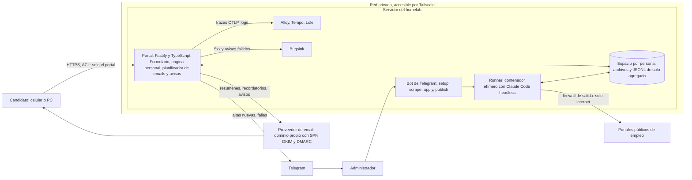

# portal-empleos

Una aplicación web en producción que ayuda a **personas no técnicas** a buscar empleo con un pipeline de IA: completan un formulario, un agente busca y analiza ofertas por ellas, y siguen todo desde una página personal.

> **Repositorio vitrina, sin código fuente.** Es un sistema en producción que guarda datos personales de personas reales, así que el repositorio del código es privado. Esta página explica el problema, el diseño, las decisiones y los resultados. Con gusto recorro el código en una entrevista.

[Read in English](README.md)

## En un vistazo

- En producción desde julio de 2026 en mi homelab ([homelab-platform](https://github.com/EduardoJRG/homelab-platform)). Hasta ahora lo usaron cinco personas en su búsqueda de empleo.
- Node.js y TypeScript (Fastify 5), zod, TDD estricto con Vitest, mutation testing, OpenTelemetry, Bugsink y Telegram.
- Claude Code corre en modo headless como agente de búsqueda, dentro de un contenedor efímero con la red restringida.
- Guiado por especificaciones: más de 30 cambios especificados, 18 registros de decisiones de arquitectura y un glosario de términos del dominio.
- La salida del agente de IA se trata como **entrada no confiable**.

## El problema

Hay buenas herramientas de código abierto para hacer una búsqueda laboral con un agente de IA: le das tu CV y tus preferencias, busca en portales de empleo, puntúa cada oferta y redacta un CV y una carta adaptados. Pero suponen una terminal: clonar un repositorio, instalar herramientas, correr comandos, editar archivos Markdown.

Las personas que más ayuda necesitan son justamente las que no pueden hacer eso. Quería el mismo pipeline para alguien que solo tiene un celular y un CV.

## La solución

1. **Formulario de alta.** La persona carga sus datos y documentos (CV y, opcionalmente, su perfil de LinkedIn) desde una sola página. La app valida todo, crea un espacio de trabajo limpio por persona a partir de una plantilla (un test garantiza que la plantilla nunca contenga datos personales) y avisa al administrador.
2. **Pipeline de IA, headless.** El administrador corre cada paso desde un bot de Telegram:
   - `setup`: arma el perfil del candidato a partir de los documentos y las respuestas, y hace preguntas cuando las fuentes se contradicen;
   - `scrape`: busca en portales públicos de empleo de Argentina y España, elegidos por país y perfil profesional, y puntúa cada oferta (encaje alto, medio o bajo);
   - `apply`: redacta un CV y una carta adaptados para cada oferta que la persona marcó como de interés;
   - `publish`: hace visibles para el candidato los borradores ya revisados.
3. **Página personal por link secreto.** Documentos, ofertas que encajan (alto y medio de los últimos 45 días; las de encaje bajo, a pedido), una marca de "me interesa", rondas de preguntas, un botón para pedir una búsqueda nueva y un formulario para avisar de un error en sus datos.
4. **Ciclo de emails.** Rondas de preguntas con un recordatorio cada 24 horas (hasta 3) y vencimiento a las 72 horas, archivadas y recuperables; como mucho un resumen de ofertas por día, y solo si hay ofertas relevantes; un único aviso por cada tanda de documentos publicada; y si pasan 14 días sin ningún email, un mensaje que explica por qué.
5. **Una persona en el circuito.** El sistema no se postula a nada en nombre de nadie. El administrador revisa los borradores antes de publicarlos, y la persona decide dónde postularse.

## Arquitectura

- **Monolito modular:** un proceso Fastify con dos contextos delimitados, `intake` (formulario, validación, aprovisionamiento) y `portal` (página personal, procesos de fondo), más los módulos transversales `security` y `observability`. Con este volumen no hay motivo para partirlo en servicios.
- **Sin base de datos, a propósito:** un log de altas de solo agregado y un directorio por candidato. Las escrituras son atómicas (archivo temporal y rename), y el estado que garantiza "avisar una sola vez" es de solo agregado, así que sobrevive a reinicios y a corridas superpuestas.
- **Planificador dentro de la app:** corre cada 30 minutos; las corridas nunca se superponen; cada pasada tiene su propio manejo de errores, así que una que falla no frena a las demás; una pasada cuyo canal no está configurado (sin email, sin Telegram) no corre, así nunca marca como enviado algo que no salió.
- **Los prompts son código de producción:** parte del comportamiento vive en los prompts del agente, en otro repositorio. Tienen tests de contrato y una única copia viva.

## Stack

| Área | Elección |
|---|---|
| Runtime | Node.js 24, TypeScript en modo estricto, Fastify 5 |
| Frontend | HTML y módulos ES sin framework, con design tokens (un formulario no necesita una SPA) |
| Validación | Esquemas zod 4 como única fuente de verdad, también para los archivos que escribe el agente |
| Persistencia | Archivos y JSONL de solo agregado, un directorio por candidato |
| Tests | Vitest con TDD estricto; nombres Given/When/Then tomados de las especificaciones; más de 150 archivos de test |
| Mutation testing | Stryker sobre los archivos que cambia cada push, con un piso por archivo; la compuerta tiene su propio test de contrato |
| CI | Forgejo Actions en una VM aislada: `npm audit --omit=dev --audit-level=high` bloqueante, lint, typecheck, tests, build, compuerta de mutación |
| Observabilidad | Trazas OpenTelemetry (OTLP) a Grafana Tempo vía Alloy, logs estructurados a Loki, errores a Bugsink (SDK compatible con Sentry), avisos al administrador por Telegram |
| Email | SMTP con Resend, desde un dominio propio con SPF, DKIM y DMARC |
| Agente | Claude Code headless, con su propia credencial de sesión, separada del entorno de desarrollo |

## Decisiones de seguridad

- **Sin exposición a internet.** Los candidatos se conectan por Tailscale. La ACL les da HTTPS al portal y DNS, y nada más de la red.
- **Acceso por link secreto.** Cada candidato recibe un token aleatorio de al menos 128 bits, que el administrador puede rotar. El token nunca sale de la app: los logs lo ocultan, y los avisos, las trazas y los reportes de error usan la plantilla de la ruta en lugar de la URL.
- **Capa web:** una Content Security Policy estricta sin `unsafe-inline` (un test falla si aparece cualquier estilo o script inline en el frontend), `nosniff`, protección contra framing, `no-referrer` y `no-store` en toda página bajo un token; límites de pedidos por token y por IP; control de origen en los envíos del formulario; el proxy de confianza es una dirección exacta, nunca un rango.
- **Archivos:** las subidas se limitan por extensión, tamaño y cantidad, y se compara la firma real del archivo con lo que dice ser. Dentro del espacio de un candidato la app solo lee y escribe archivos regulares, a través de un directorio abierto (`O_NOFOLLOW`, `/proc/self/fd`), después de que dos revisiones independientes reprodujeran una carrera con enlaces simbólicos que podía hacer que la app escribiera en los archivos de otro candidato.
- **La salida del agente es entrada no confiable.** Cada archivo que escribe el agente se valida con esquemas estrictos. Un archivo inválido se trata como ausente (la página no muestra nada antes que mostrar algo incorrecto) y el administrador recibe un aviso que nombra el campo, nunca su valor.
- **Aislamiento del pipeline:** cada paso corre en un contenedor efímero con un directorio home descartable, montajes de solo lectura para los documentos publicados y el estado del pipeline, y un firewall de salida que bloquea la LAN, la VPN, las direcciones link-local y el host. Solo se alcanza internet.
- **Contenedor:** usuario no root, `no-new-privileges`, límite de memoria de 1 GB y de 512 PIDs (pico medido: unos 190 MiB en 60 días).
- **Secretos como archivos montados** (variables `*_FILE`). La app no arranca si un archivo de secreto no se puede leer, está vacío o tiene más de una línea, y el error nombra la variable y la ruta, nunca el contenido.
- **Dependencias:** `npm audit` sobre las dependencias de producción con severidad alta bloquea el CI.
- **Scraping:** se respetan las reglas de robots.txt, y los portales con protección anti-bot quedan afuera en lugar de esquivarla.

## Resultados

- **Cinco personas** lo usaron en su búsqueda de empleo, sin tocar una terminal.
- El flujo completo funciona de punta a punta con candidatos reales: marcar una oferta, recibir documentos adaptados, revisar, publicar, aviso por email.
- Para un candidato, el pipeline evaluó más de 800 ofertas en distintos portales, y la página muestra solo las relevantes.
- **Sin fallas silenciosas por diseño:** cualquier 5xx se muestra al usuario y se reporta al administrador y al registro de errores; los avisos fallidos también se registran; las reglas que cambian con el tiempo lo que ve el candidato avisan al administrador cuando empiezan a actuar.
- Los deploys se verifican (chequeo de salud y una prueba de escritura) y cada deploy deja una imagen etiquetada para volver atrás.

## Notas de ingeniería

Cosas que aprendí construyéndolo, cada una convertida en un mecanismo:

- **"Los tests pasan" no es "los tests atraparían un bug".** En un cambio, revertir la línea central dejó los 351 tests en verde. Desde entonces el CI corre una compuerta de mutation testing sobre los archivos cambiados. Su alcance está dicho con honestidad: cubre lo que toca cada push, no la suite histórica.
- **Un CI que nunca corrió se ve igual que uno que pasa.** El workflow apuntaba a una etiqueta de runner que no existía; 84 corridas quedaron en cola y se cancelaron, y nadie lo notó durante semanas. Ahora controlo que las corridas efectivamente arranquen, no solo que nada esté en rojo.
- **Las reglas que dispara el calendario salen a producción dormidas.** Una ventana de visibilidad de 45 días hizo fallar tests semanas después del último commit, porque los fixtures se comparaban contra el reloj real. Hoy cada test con fechas inyecta un reloj fijo, y cada regla basada en el tiempo avisa al administrador cuando empieza a cambiar lo que ve el candidato.
- **Un token rotado puede fallar en silencio.** Una vez los avisos fallaron con HTTP 401 y solo el log lo sabía. Ahora las fallas manejadas también se reportan al registro de errores, no solo las no manejadas.

## Qué haría después

- **Decidir con datos sobre un modelo local chico.** Un modelo ajustado de 0.8B corre en modo sombra en CPU después de cada búsqueda (p95 de unos 4,4 s por oferta) y puntúa ofertas sin afectar nada. Se compara con las etiquetas del agente; adoptarlo necesitaría más datos etiquetados por personas de los que hay hoy.
- **Una pantalla "Tus datos".** El pipeline ya registra de dónde salió cada campo del perfil (CV, respuesta, LinkedIn); todavía nada se lo muestra al candidato.
- **Límites de pedidos por candidato para quienes entran por la VPN**, que hoy comparten una misma dirección de origen y un mismo cupo.
- **Búsquedas programadas** (hoy el administrador las lanza a pedido), con un presupuesto para el cupo de uso de IA, que se comparte con otras tareas.
- **Archivar las ofertas ya avisadas con lápidas** cuando la lista crezca. Hoy crece sin límite a propósito: es la única defensa contra avisar dos veces la misma oferta.

## Licencia

El texto de este repositorio está bajo la [licencia MIT](LICENSE).
