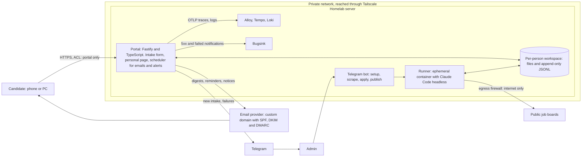

# portal-empleos

A web app in production that helps **non-technical people** search for jobs with an AI pipeline: they fill in a form, an agent finds and analyzes job postings for them, and they follow everything from a personal page.

> **Showcase repository, no source code.** This is a production system that holds personal data of real people, so the code repository is private. This page explains the problem, the design, the decisions and the results. Happy to walk through the code in an interview.

[Leer en español](README.es.md)

## At a glance

- In production since July 2026 on my homelab ([homelab-platform](https://github.com/EduardoJRG/homelab-platform)). Five people have used it in their job search so far.
- Node.js and TypeScript (Fastify 5), zod, strict TDD with Vitest, mutation testing, OpenTelemetry, Bugsink and Telegram.
- Claude Code runs headless as the job-search agent, inside an ephemeral, network-restricted container.
- Spec-driven: 30+ specified changes, 18 architecture decision records and a glossary of domain terms.
- The AI agent's output is treated as **untrusted input**.

## The problem

There is good open-source tooling to run a job search with an AI agent: you give it your CV and preferences, it searches job boards, scores each posting and drafts a tailored CV and cover letter. But it assumes a terminal: clone a repository, install tools, run commands, edit Markdown files.

The people who need help the most are the ones who cannot do that. I wanted the same pipeline for someone who only has a phone and a CV.

## The solution

1. **Intake form.** The candidate submits their details and documents (CV, optionally a LinkedIn profile) from a single page. The app validates everything, provisions a clean per-person workspace from a template (a test guarantees that the template never contains personal data) and notifies the admin.
2. **AI pipeline, headless.** The admin runs each step from a Telegram bot:
   - `setup`: builds the candidate profile from the documents and the answers, and asks follow-up questions when sources contradict each other;
   - `scrape`: searches public job boards for Argentina and Spain, chosen by country and professional profile, and scores each posting (high, medium or low fit);
   - `apply`: drafts a tailored CV and cover letter for each posting the candidate marked as interesting;
   - `publish`: makes the reviewed drafts visible to the candidate.
3. **Personal page by secret link.** Documents, matching jobs (high and medium fit from the last 45 days; low fit on request), an "I'm interested" mark, question rounds, a button to request a new search and a form to report a mistake in their data.
4. **Email lifecycle.** Question rounds with a reminder every 24 hours (up to 3) and expiry after 72 hours, archived and recoverable; at most one job digest per day, and only when there are relevant matches; one notice per published batch of documents; and if 14 days pass without any email, a message that explains why.
5. **Human in the loop.** The system does not apply to jobs on anyone's behalf. The admin reviews the drafts before publishing them, and the candidate decides where to apply.

## Architecture

- **Modular monolith:** one Fastify process with two bounded contexts, `intake` (form, validation, provisioning) and `portal` (personal page, background jobs), plus cross-cutting `security` and `observability` modules. There is no reason to split it into services at this volume.
- **No database, on purpose:** an append-only log of submissions and one directory per candidate. Writes are atomic (temporary file and rename), and the state that guarantees "notify only once" is append-only, so it survives restarts and overlapping runs.
- **In-app scheduler:** runs every 30 minutes; runs never overlap; each pass has its own error handling, so one failing pass cannot stop the others; a pass whose channel is not configured (no email, no Telegram) does not run, so it never marks something as sent when it was not.
- **The prompts are production code:** part of the behavior lives in the agent's prompts, in another repository. They have contract tests and a single live copy.

## Stack

| Area | Choice |
|---|---|
| Runtime | Node.js 24, TypeScript in strict mode, Fastify 5 |
| Frontend | Plain HTML and ES modules with design tokens (a form does not need a SPA) |
| Validation | zod 4 schemas as the single source of truth, also for files the agent writes |
| Storage | Files and append-only JSONL, one directory per candidate |
| Tests | Vitest with strict TDD; test names in Given/When/Then taken from the specs; 150+ test files |
| Mutation testing | Stryker on the files changed by each push, with a per-file floor; the gate has its own contract test |
| CI | Forgejo Actions on an isolated VM: blocking `npm audit --omit=dev --audit-level=high`, lint, typecheck, tests, build, mutation gate |
| Observability | OpenTelemetry traces (OTLP) to Grafana Tempo through Alloy, structured logs to Loki, errors to Bugsink (Sentry-compatible SDK), admin alerts on Telegram |
| Email | SMTP through Resend, from a custom domain with SPF, DKIM and DMARC |
| Agent | Claude Code headless, with its own session credential, separate from the development environment |

## Security decisions

- **Not exposed to the internet.** Candidates connect through Tailscale. The ACL grants them HTTPS to the portal and DNS, and nothing else on the network.
- **Access by secret link.** Each candidate gets a random token of at least 128 bits, which the admin can rotate. The token never leaves the app: the logs redact it, and alerts, traces and error reports use the route template instead of the URL.
- **Web layer:** a strict Content Security Policy without `unsafe-inline` (a test fails if any inline style or script appears in the frontend), `nosniff`, anti-framing, `no-referrer` and `no-store` on every page under a token; rate limits per token and per IP; origin checks on form submissions; the trusted proxy is an exact address, never a range.
- **Files:** uploads are limited by extension, size and count, and the real file signature is compared with what the file claims to be. Under a candidate's workspace the app reads and writes only regular files, through an open directory handle (`O_NOFOLLOW`, `/proc/self/fd`), after two independent reviews reproduced a symlink race that could make the app write into another candidate's files.
- **The agent's output is untrusted input.** Every file the agent writes is parsed with strict schemas. An invalid file is treated as absent (the page shows nothing rather than something wrong) and the admin gets an alert naming the field, never its value.
- **Pipeline isolation:** each step runs in an ephemeral container with a disposable home directory, read-only mounts for published documents and pipeline state, and an egress firewall that blocks the LAN, the VPN, link-local addresses and the host. Only the internet is reachable.
- **Container:** non-root user, `no-new-privileges`, a 1 GB memory limit and a 512 PID limit (measured peak: about 190 MiB over 60 days).
- **Secrets as mounted files** (`*_FILE` variables). The app refuses to start if a secret file is unreadable, empty or has more than one line, and the error names the variable and the path, never the content.
- **Dependencies:** `npm audit` on production dependencies at high severity blocks CI.
- **Web scraping:** robots.txt rules are respected, and boards with anti-bot protection are left out instead of bypassed.

## Results

- **Five people** have used it in their job search, without touching a terminal.
- The whole flow works end to end with real candidates: mark a posting, get tailored documents, review, publish, email notice.
- For one candidate, the pipeline has evaluated more than 800 job postings across boards, and the page shows only the relevant ones.
- **No silent failures by design:** any 5xx is shown to the user and reported to the admin and to the error tracker; failed notifications are tracked too; rules that change what the candidate sees over time alert the admin when they kick in.
- Deploys are verified (health check and a write smoke test) and every deploy leaves a rollback image tag.

## Engineering notes

Things I learned building it, each one turned into a mechanism:

- **"Tests pass" is not "tests would catch a bug".** In one change, reverting the central line left all 351 tests green. Since then CI runs a mutation-testing gate on the changed files. Its scope is stated honestly: it covers what each push touches, not the historical suite.
- **A CI that never ran looks exactly like a CI that passes.** The workflow targeted a runner label that did not exist; 84 runs sat in the queue and were cancelled, and nobody noticed for weeks. Now I check that runs actually start, not only that nothing is red.
- **Rules triggered by the calendar ship inert.** A 45-day visibility window made tests fail weeks after the last commit, because fixtures were compared against the real clock. Every test with dates now injects a fixed clock, and every time-based rule notifies the admin when it starts changing what the candidate sees.
- **A rotated token can fail silently.** Notifications once failed with HTTP 401 and only the log knew. Handled failures are now reported to the error tracker, not only unhandled ones.

## What I'd do next

- **Decide on a small local model with data.** A fine-tuned 0.8B model runs in shadow mode on CPU after every search (p95 about 4.4 s per posting) and scores postings without affecting anything. It is compared against the agent's labels; adopting it would need more human-labeled data than there is today.
- **A "Your data" screen.** The pipeline already records where each profile field came from (CV, answer, LinkedIn); nothing shows it to the candidate yet.
- **Per-candidate rate limits for VPN users**, who currently share one source address and one quota.
- **Scheduled searches** (today the admin starts them on demand), with a budget for the AI usage quota, which is shared with other jobs.
- **Archive notified postings with tombstones** once the list gets large. Today it grows without limit on purpose: it is the only guard against notifying the same posting twice.

## License

The text in this repository is under the [MIT License](LICENSE).
